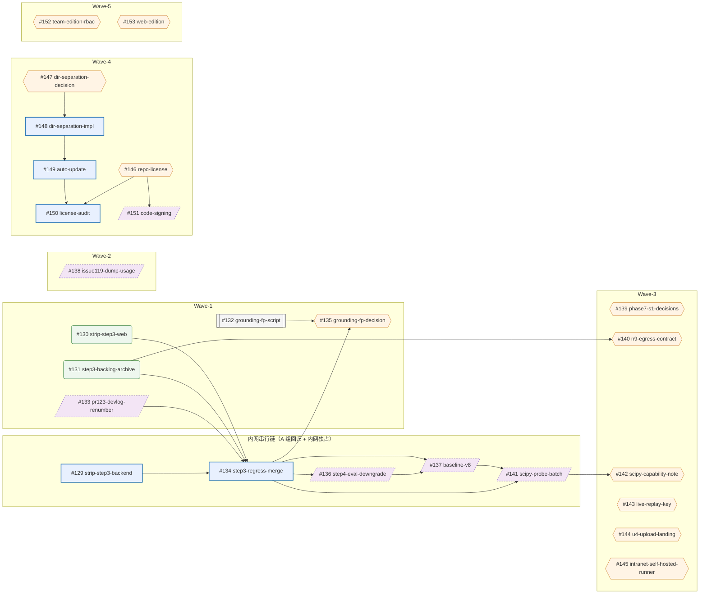

# DataChat 总体计划书（issue 驱动开发）

> 状态：**第二版（v2），已吸收 S 11-25 的裁定（含 11-25 第二轮修订：#134 执行分工、DEVLOG 编号链、D 号去歧义、安装目录写法、HANDOVER、B4 挂账）**。issue 已按 S 同意建到 GitHub，25 个子 issue 已由评测侧挂为追踪 issue #128 的 sub-issue。本文件随计划书文档 PR（DEVLOG [210]）提交；该 PR 等 S 批准后才合并。
> 基于 origin/master `9c40a97`（DEVLOG 到 [209]），2026-11-25 起草，同日出 v2 并修订。
> 「任务书」指 S 11-25 下发的本计划书任务说明（含「当前事实」「规则」「顺序已定」「待 S 定」四段），不在仓库里；各 issue 背景里凡写「任务书」的，出处即此。
> 配套文件：`docs/roadmap/issues/INDEX.md`（总表）、`docs/roadmap/issues/I-xx-*.md`（25 份 issue 全文，文件名保留草稿编号）、`.github/ISSUE_TEMPLATE/task.md`（模板）、`docs/HANDOVER.md` §7.1「issue 驱动流程」（给接手者的流程摘要）。

## 1. 目标与终点

**目标**：把现有路线图（phase75 第 3、4 步、v8 基线、挂起的决策、对外分发前置项）拆成可独立交付、可自动验收的 issue，用依赖图管顺序，用内网串行链管 A 组回归，用只读审查管「做的就是计划的」。

**终点（本计划覆盖到哪里为止）**
1. 第 3 步收口：#127 摘除 S3-3 与 S3-2 产品闸后合入（S3-1 + code_scope 搬家留在 master），摘下的部分在 BACKLOG 可追溯；S3-4 假阳率读数交 S。
2. 第 4 步评测降级（评测侧）完成，v8 基线（评测侧）按三跑中位数立起来（顺序：第 3 步 → 第 4 步 → v8，任务书「顺序已定」）。
3. 所有仍「待 S 定」的事项都有一个 Decision issue 承载，S 的决定落在 issue 评论里；会引出实现的，明确写「另开 issue、接内网链尾」。已经定了的事项（B4 第二家族 Key、react 同步注入）不再建 Decision issue。
4. 对外分发前置项（目录分离、自动更新、许可证、代码签名（证书申请与 CI 签名，#151））排好依赖，等 S 宣布对外分发时可直接开工。
5. Web 版、团队版只到「何时另开方案」的决策为止，不在本计划内写方案。

**不在本计划内**（材料里有、但没有决定或没有触发条件，不硬造 issue）：phase7 E/A 系列（整体推迟，等 #139）；M13 `bar_line` 双轴图型（phase76-ui §5 第 3 条「另起评估」）；BACKLOG N8 `exec_timeout` 可配置（「可以考虑」，未决）；P14 计划过长时在 codegen 追加提示（`app/assess/contracts.py:8` 写明 #105 待定第 1 条，未决）；S3-4 若决定拦截后的实现、N9 修法、scipy 能力说明——这些都等对应 Decision 定了再开实施 issue。react 链路同步注入已定「不同步、挂账」（phase75-step3 §7 第 4 条），挂账条目由 #131 写进 BACKLOG，等 react 下一次改 prompt 时再开实施 issue。B4 第二家族 Key 已定不需要（DEVLOG [196]/[199]：GLM-5.2 校准 κ=1.000，opencode 交叉校验转为可选触发项），不建 issue；触发式交叉校验的三个触发条件作为 B4 挂账记在 #139 正文。

## 2. Wave 划分及门槛

| Wave | 标签 | 内容 | 进入门槛 | 退出门槛（下一 Wave 可开工） |
|---|---|---|---|---|
| 1 | `wave:1-step3-closeout` | #129、#130、#134、#131、#132、#135、#133：#127 摘除（后端 / 前端 / 挂账）、#123 先合让号、回归与合并、S3-4 量测与决策 | 现在（master 9c40a97；计划书 PR 先合，占 DEVLOG [210]） | **#134 合入**：#127 squash 进 master（DEVLOG [213]），本地闸门全绿、CI 三工作流 success、内网 nightly_gate GREEN（配对净退步 <6）+ canary 无阻断，A 组 code_sha12 已登记。#133 是 #134 的前置（必须先合），且 #133 要等计划书 PR 合并后才执行；#132/#135 不挡 Wave-2 |
| 2 | `wave:2-eval-downgrade` | #136 第 4 步评测降级（外部）、#137 v8 基线（外部）、#138 #119 收尾（外部） | Wave-1 退出 | #136 合入（触 A 组时其内网回归 GREEN）且 #137 v8 登记，三份报告同 code_sha12 / evalset 指纹、中位数可由报告复算 |
| 3 | `wave:3-decisions` | #139、#140、#141、#142、#143（第 1 步 replay live 模式真模型 Key 决策）、#144、#145：待 S 定事项 + scipy probe 批（外部） | 各 Decision 无门槛，随时可交 S；#140 需 #131（材料），#141 需 #134 与 #137（内网队列），#142 需 #141 | 无整体退出门槛；每个 Decision 关闭 = S 在评论里给出可执行的决定 |
| 4 | `wave:4-pre-distribution` | #146 仓库许可证、#147/#148 目录分离、#149 自动更新、#150 依赖许可证审计、#151 代码签名 | **S 宣布对外分发**（phase6-desktop:11：签名、许可证、THREAT_MODEL (a) 重新确认，三者缺一不可） | 安装包签名、带 NOTICES、可自动更新；THREAT_MODEL (a) 由 S 重新确认 |
| 5 | `wave:5-next-form` | #152 团队版 / RBAC、#153 Web 版 | 无（只是决策） | S 定是否 / 何时另开方案 |

## 3. 五类节点定义

| 类型 | 标题标记 | `exec:` 标签 | 定义 | 图中形状 |
|---|---|---|---|---|
| 串行闸 | `[Serial-Gate]` | `serial` | 后续节点必须等它**合入**才能开工；或者它占用一个只能串行的资源（内网、链上独占文件）。内网串行链上的我方节点都是串行闸（外部节点除外，见下） | 矩形 `[ ]`，蓝边 |
| 并行 | `[Parallel-A/B/C…]` | `parallel` | 有兄弟 issue，与兄弟同时开工。**「并行」的定义：兄弟 issue 之间独占修改边界两两不相交**（DEVLOG 例外，见 §8）。同时在跑的实施 subagent 不超过 2（沙箱并行度上限） | 圆角 `( )`，绿边 |
| 独立 | `[Independent]` | `independent` | **没有兄弟 issue**、没有前置依赖、不占内网，随时能开工；可以解锁决策节点。它不属于「并行」，因为并行是对兄弟而言的（边界两两不交），独立节点没有兄弟可比；它也不是串行闸，因为不占任何串行资源。实施 subagent 仍计入并行度上限 2 | 子程序框 `[[ ]]`，灰边 |
| 决策 | `[Decision]` | `decision` | 只由 S 拍板，不改代码；决定写在 issue 评论里。会引出实现的，另开实施 issue | 六边形 `{{ }}`，橙边 |
| 外部 | `[External]` | `external` | 由评测侧或外部主体（证书 CA、有主体的一方）完成，我方只提需求和验收口径；评测侧节点若触 A 组或占内网，同样按链序排队（#136、#137、#141 都在链上） | 平行四边形 `[/ /]`，紫色虚线边 |

> **已定（11-25）**：保留第五类 `[Independent]` / `exec:independent`（目前只有 #132）。理由：#132 没有兄弟 issue，不占内网，随时能开工；按上面「并行」的定义它没有可比的兄弟，归不进 Parallel。
>
> **试点拆法（已定，11-25）**：#127 摘除仍拆成 4 个 issue、对应 1 个 PR——#129（后端）、#130（前端）、#131（挂账与快照）三个实施 issue 并行，汇到 #134（本地闸门 + 内网 + 合并）。拆开是为了让每个实施 issue 的独占修改边界都可以单独验证（`git diff --stat` 对清单逐项比对），合成一个 issue 就无法证明「后端、前端、文档」三块互不越界。

## 4. 依赖图

箭头 A → B 表示「B 的前置依赖含 A」。`CHAIN` 子图是内网串行链（A 组回归 + 内网独占）。

## 5. 内网回归链的排序与理由

**规则**（任务书「规则」）：A 组文件（`app/eval/fingerprint.py:38` `_AFFECTS_RESULTS`）的改动必须跑内网回归；内网只能串行。所以所有触 A 组或占内网的 issue 排成一条链，链上每一环必须等前一环**合入**（不是写完）才开始内网回归，否则回归测的不是 master 的真实组合。

**链**：`#129 → #134 → #136 → #137 → #141`

| 链序 | 节点 | 是否改 A 组 | 占内网做什么 | 为什么排在这里 |
|---|---|---|---|---|
| 1 | #129 #127 摘除后端 | 是（graph/state/nodes/core/tools/sanity/code_scope/assess.snapshot） | 不占（只产出待回归的 head） | 链头：#134 回归的对象 |
| 2 | #134 本地闸门 + 内网一批 new + 合并 | 不改代码；回归 #129 的 A 组变更 | 评测侧在内网跑一批 202 题 + nightly_gate 判读 + canary（gate 只指 nightly_gate，不含 docs/gate 25 题外部闸门）；本地闸门与 push/CI 由我方在 worktree 做 | phase75-assess:42 第 4 步依赖第 1–3 步；S3-1 改全局 prompt，按 §3:71 须全量 202。另需计划书 PR（[210]）与 #133（#123，[211]/[212]）先合，#127 接 DEVLOG [213] |
| 3 | #136 第 4 步评测降级（外部） | 子集入口若改 `app/eval/runner.py` 则是 | 触 A 组时回归一次 | 顺序已定（第 3 步 → 第 4 步）；在 #134 之后可避免两份 A 组变更叠在一次回归里分不清归因 |
| 4 | #137 重立 v8（外部，评测侧执行） | 否 | 机器空闲时连跑三次 | 顺序已定（第 4 步 → v8）；若先立 v8，#136 改 A 组会让 v8 的 code_sha12 立即失效 |
| 5 | #141 scipy probe 批（外部） | 否 | 单独 3 题 | 不在关键路径；放在 v8 之后，不打断 v8 要求的「机器空闲」三连跑；且须在 S3-1 合入后测才有意义（phase75-scipy §3④ 补充②） |

**链尾追加规则**：今后任何 Decision 定下来引出 A 组实现（S3-4 拦截、N9 修法、scipy 能力说明、react 注入挂账重启、团队版改编排…），新 issue 一律接到当时的链尾，前置写链上最后一环，并在编排块写「内网串行链第 k 环」。#148（目录分离）若选方案二只改 `app/server/`（B 组，`fingerprint.py:139`），不进链。

**不叠链（已定，11-25）**：每个 A 组改动合入后**单独回归**一次，不把相邻两环叠在一起只跑链尾。理由：保证每次读数只对应一份 A 组变更，归因干净（第 3 步刚把 S3-3 摘掉，尤其需要）。11-21 曾用过的「叠链只跑链尾」做法不再作为本计划的选项。

## 6. 节点语义一致性对比流程

适用于 serial / parallel / independent 三类实施节点（决策、外部节点不适用，外部节点我方只做验收）。

1. **实施 subagent 交付**：在 issue 指定的分支 / worktree 上完成，附交接报告（改了什么、偏离及理由、测试名、闸门读数、code_sha12）。不 commit 以外的任何写操作（不 push、不改 PR、不评论）。
2. **只读审查 subagent**：另起一个 subagent，只给它：issue 全文、分支 diff（`git diff origin/master...HEAD`）、交接报告。它**不得修改任何文件**，只运行只读命令（git diff/show/grep、跑测试）。输出一张表：

   | 计划项（issue 字段 / 节点 k） | 实际（做了什么） | 是否偏离（无 / 有-已说明 / 有-未说明） | 证据（文件:行号 / 测试名 / 命令输出） |
   |---|---|---|---|

   每个「本次只解决」条目、每个「明确不做」条目（证明没做）、每个节点的通过标准、每个验收标准各占一行；独占修改边界额外一行，证据是 `git diff --stat` 与边界清单的比对结果。
3. **迭代**：表中出现「有-未说明」或证据不成立时，退回实施 subagent 修改或补说明，再审。**最多两轮**。
4. **升级**：两轮后仍有未解决偏离，停下，把对比表和双方意见一起交 S 裁定，不自行合并。
5. **留痕**：最终对比表贴到 issue 评论（由主代理贴，需 S 同意后才对外发布，见 §7）。偏离若被 S 接受，写进 DEVLOG「偏离及理由」并带代码证据（HANDOVER §3「偏离要带代码证据」）。
6. 并行度：实施与审查 subagent 合计同时不超过 2 个。

## 7. 审批点

**角色（S 11-25 定）**：
- **S**：仓库主人，只做审批（下表）。在 #134 上只做两件事：批准 push、批准合并。
- **我方**（主代理 + 实施 / 只读审查 subagent）：在 worktree 里实施、跑本地闸门、push、等 CI、写 DEVLOG 与 PR 描述，S 批准后执行合并。
- **评测侧**：内网机上的回归（#134 节点 3：一批 new → nightly_gate 判读 → canary；取 head 一律用完整 40 位 SHA 的 codeload tarball，环境路径见 #134「环境 / 前置条件」）、External issue（#133、#136、#137、#138、#141）。

以下动作**必须** S 明确同意（HANDOVER §3、审批规则）：

| 审批点 | 涉及 issue |
|---|---|
| 把本计划与 25 份草稿建成 GitHub issue、打标签（**11-25 已同意并执行**） | 全部 |
| 计划书本身的文档 PR（commit / push / 开 PR 已于 11-25 执行；**合并**仍须 S 批准） | — |
| 每次 commit 汇报后 push、开 PR、改 PR 描述、force-with-lease | #129、#130、#134、#131、#132、#148、#149、#150 |
| 在 issue / PR 上发评论（含审查对比表、回归读数） | 全部实施节点（#134 除外：S 在 #134 只批 push 与合并） |
| 内网回归何时跑 | #136、#137、#141（#134 节点 3 由评测侧在 CI 通过后执行，不另设 S 审批点） |
| squash 合并（标题带 `(#N)`，commit body = PR 描述全文，phase75-assess:98） | #134、#132、#135、#133（#123）、#148、#149、#150 |
| 摘除范围最终确认（#129 节点 2 的 7 文件清单） | #129 |
| 评测侧共享文件改动面发给评测侧过目（code_scope 搬家仍触 `app/assess/`，phase75-step3 §3） | #129 |
| 粘贴 `TAURI_SIGNING_PRIVATE_KEY` 等 Secret（私钥不进仓库、不进对话） | #149、#151 |
| 每个 Decision 的决定 | #135、#139、#140、#142、#143、#144、#145、#146、#147、#152、#153 |
| 对外分发启动、THREAT_MODEL (a) 重新确认 | Wave-4 门槛 |

**决定落档**：Decision 关闭时以评论为准；落到仓库文档（decisions-pending-1120.md 的「决定」列或对应方案文件）随第一个触及该文件的实施 PR 一起提交，没有后续实施的，攒到下一个 docs PR。#135 例外：它自带附录。

## 8. DEVLOG 与 issue 的对应方式

1. **一个实施 PR 一条 DEVLOG**；标题行写 issue 号，形如 `## [N] 日期 · 内容（issue #X）· commit <待提交>`（沿用 [205]、[206] 的写法）。Decision / External issue 不单独写 DEVLOG；外部节点由评测侧按其惯例写。
2. **编号在合并时定**：合并前 fetch master，以 `git show origin/master:docs/DEVLOG.md` 的末条号 +1 为准（不看任何本地工作树）；与在途 PR 撞号时「后合者 rebase 接号」（phase75b §3）。草稿和分支上一律写 `[待编号]`。本轮已定的编号链（S 11-25）：计划书 PR 占 [210] → #133（#123）占 [211]/[212]（要等计划书 PR 合并后才执行）→ #134（#127）squash 接 [213]；#134 合并前若 master 末条不是 [212]，停下报告。
3. **SHA 回填**：本条 commit 写 `<待提交>`，下一次提交回填上一条的 squash SHA（HANDOVER §4 末条）。[209] 已由计划书 PR 回填为 9c40a97；[210]（计划书 PR）由下一次提交（#133 的 #123）回填。
4. **DEVLOG 不计入独占边界**：它是追加型共享台账，并行兄弟各自在末尾追加，冲突按第 2 条解；但同一条目只能由一个 issue 写（例：#127 的条目只由 #134 写，#129/#130/#131 把内容交给 #134 汇总）。
5. **issue ↔ DEVLOG 反查**：合并后在 issue 评论贴 DEVLOG 号与 master SHA，再关 issue；INDEX.md 的「GitHub #」列已回填真实编号。
6. **内容口径**：DEVLOG 只记决策与理由，「做了什么」交给 git log，squash commit body 承接 PR 描述全文（phase75-assess §5:98）。A 组改动必须登记 code_sha12 前后值。

## 9. 风险

| 风险 | 影响 | 缓解 |
|---|---|---|
| 摘除不干净：S3-1 与 S3-2 在 `reviewer.py`、`code_scope.py` 同文件交织，误删保留部分或残留产品闸 | 回归测的不是 S 认可的组合 | #129 验收用 `git diff --stat origin/master -- app/` 恰为 7 文件 + 哨兵测试 + golden 逐字节；哨兵「回退红」是硬性验收；#134 读数跌破 190 时先查摘除；审查 subagent 逐行核对 |
| 摘除后 P8 哈希与 #127 报告不一致 | 测试红或被误改期望 | #129 节点 4：不一致须归因，不许直接改期望（HANDOVER §3 判定表纪律） |
| 内网是单点且只能串行；评测侧内网机不可用时整条链停 | Wave-1/2 卡住 | 链外节点（#130、#131、#132、Decision）照常推进；不叠链（§5），宁可等也不混归因 |
| 单批回归的噪声带（n=202 约 ±6 题，phase75-assess §0） | 一次 GREEN 不代表无退步 | 判据用配对净退步（#111 B5），v8 用三跑中位数 |
| 计划书 PR、#123、#127 三方 DEVLOG 撞号 | 台账错号 | 已定编号链：计划书 PR [210]（同时回填 [209]=9c40a97）→ #133（#123）[211]/[212] → #134 [213]（图中 #133 → #134）；#134 的守卫：末条不是 [212] 就停下报告；§8 第 2、3 条 |
| **S 本机工作树过时**：`D:\Coding\claude\datachat` 停在 d84363c，还带着未提交的 DEVLOG 改动 | 在那台机器上看或改 DEVLOG 会看到错的末条号，出现「撞号」假象 | 在那台机器上动 DEVLOG 之前，必须先 fast-forward 到 origin/master 并清理工作树（未提交改动先另存再丢弃）；核对 DEVLOG 一律以 `git show origin/master:docs/DEVLOG.md` 为准（写进 #134 环境与节点 4） |
| 评测侧第 4 步改 `app/eval/runner.py`（A 组）却未声明 | 跳过内网回归 | #136 验收需求里写明，按链序；指纹变化在 PR 里登记 |
| 网关 prompt cache 可能已关（#123「成本警讯」） | 每轮评测成本近翻倍，影响 v8 三跑与 phase7 预算 | #139 预算决策引用；#137 前确认网关方答复 |
| 快照文件交付有误（不是 mul_005#2 或不含 replan 节点） | 存错验收材料 | #131 节点 2：收到后核对 case_id=mul_005、含 replan 节点再入库，sha256 写进 BACKLOG |
| 决策长期不定（11 个 Decision） | 后续实施无法排期 | Decision 不挡 Wave-1/2；每个 Decision 写清「不定会卡住什么」 |

## 10. 自检方法（交付前已执行）

- 生成：`docs/roadmap/issues/*.md` 与 INDEX.md 由一份数据生成，边只写一次。
- 校验（只读 md 反解析，不读数据源）：① 前置 ↔ 解锁对称；② 依赖图无环（Kahn 拓扑排序）；③ 兄弟关系对称、兄弟间独占边界无路径重叠（DEVLOG 例外）、兄弟间无依赖边；④ 边界命中 `fingerprint._AFFECTS_RESULTS` 或带 `regress:intranet` 的 issue 全在链上、链上相邻两环是依赖边、链上节点编排块写了链序；⑤ 标题格式、标签、11 字段、出处齐全；⑥ INDEX 与文件一致。
- mermaid：用 mermaid@11 + jsdom 的 `mermaid.parse` 解析本文件 §4 的代码块（另以一段坏语法做反例，确认解析器会拒）。
- 检查脚本与输出随交付报告提供，不入库。

## 11. Issue 一览（按 Wave）

见 `docs/roadmap/issues/INDEX.md`；GitHub 上的追踪 issue 为 #128（[Tracking] issue 驱动开发总图），25 个子 issue 已由评测侧挂为它的 sub-issue。

## 12. 需要 S 定的计划层面问题

1. **已定（11-25）**：第五类「独立」保留 `[Independent]` / `exec:independent`（#132）。理由见 §3：没有兄弟 issue，不占内网，随时能开工；「并行」= 兄弟 issue 之间修改边界两两不相交。
2. **已定（11-25）**：试点仍拆成 4 个 issue、对应 1 个 PR（#129/#130/#131 → #134），拆开是为了让独占边界可以验证。
3. **已定（11-25）**：#134 的 gate 只指 nightly_gate 的判读，不含 docs/gate 那 25 题外部闸门（#127 和本次摘除都没动判分、gold 和 gate answers）。已写进 #134 环境 / 前置条件，节点数不变。
4. **已定（11-25）**：默认不叠链，每个 A 组改动合入后单独回归（§5）；去掉了「叠链只跑链尾」的可选项。
5. **已定（11-25）**：#137 改为 `[Wave-2][External]`、`exec:external`，由评测侧执行（内网跑批一直是评测侧在内网机上跑）；链位不变，仍是 #136 → #137 → #141。
6. **已定（11-25）**：mul_005#2 快照入库，路径 `docs/eval/archives/step3-mul_005-replan/`，不放 tests/fixtures；数据来自 data/eval 下的合成数据，不涉及出境、无许可问题；sha256 写进 BACKLOG 条目。源文件在评测侧内网机 `D:\Coding\claude\_ver\snap_new\20261125T011905485445Z_214afb99c9bd438d914facf8e1b2f34e.jsonl`，由评测侧打包交付；#131 收到后先核对 case_id=mul_005、含 replan 节点再入库。
7. **已定（11-25）**：S3-4 人工标注由评测侧做，S 抽查不少于 10%（#132、#135 已同步）。
8. **已定（11-25）**：第 4 步「四件」= 回归范围表 + 子集入口 + 指纹降为报告元数据 + LEDGER 机读；出处是 phase75-step3.md §8 原文「四件一起做」，phase75-assess §2 第 4 行第一句本身含两件（回归范围表、子集入口）。#136 正文加了口径注解，结构不变。
9. **已定（11-25，同日修订）**：计划书 PR 定为 DEVLOG [210]（并回填 [209]=9c40a97）；#123（#133）要等计划书 PR 合并后才执行，让号到 [211]/[212]，先于 #127 合并（依赖 #133 → #134）；#134 的 #127 squash 定为 [213]，守卫为「若末条不是 [212]，停下报告」。#133 仍是 External，由评测侧执行；#123 的标题由评测侧改。
10. **已定（11-25）**：删除原 #144（B4 第二家族 Key：DEVLOG [196]/[199]，GLM-5.2 校准 κ=1.000）与原 #146（react 同步注入：phase75-step3 §7 第 4 条「不同步、挂账」），react 挂账并入 #131；其余 issue 重新连续编号为 #129…#153。
11. **已定（11-25）**：HANDOVER 不另开 issue；在 `docs/HANDOVER.md` §7 末尾新增「issue 驱动流程」一节（§7.1），随本计划书 PR 提交（见 §13 第 8 条）。
12. **已定（11-25）**：#134 执行分工——节点 1/2（本地闸门、push、CI）我方在 worktree 做；节点 3（一批 new → nightly_gate 判读 → canary）由评测侧在内网执行，环境走既定路径（完整 40 位 SHA 的 codeload tarball → 解压到 `D:\Coding\claude\_ver` → 从原仓库拷 `.env` → `set PYTHONUTF8=1` → conda 环境 `dc` 里用 python 跑）；S 只批准 push 与合并（§7）。

## 13. 材料矛盾

1. **已定（11-25）**：第 4 步「四件」与 phase75-assess §2 第 4 行「只列三件」——结论：四件 = 回归范围表 + 子集入口 + 指纹降为报告元数据 + LEDGER 机读，§2 第 4 行第一句含两件，不矛盾（见 #136 注解）。
2. **已定（11-25）**：react 同步注入在任务书列为「待 S 定」，但 phase75-step3 §7 第 4 条已写「不同步、挂账」——结论：以 §7 第 4 条为准，不建 Decision issue，挂账并入 #131。
3. **已定（11-25）**：B4 第二家族 Key 在任务书列为「待 S 定」，但 DEVLOG [196]/[199] 已校准 κ=1.000 并把 opencode 交叉校验转为可选触发项——结论：已决定，不建 issue；触发式交叉校验（三个触发条件照录 DEVLOG [199] 原文）作为 B4 挂账写进 #139 正文。
4. **已定（11-25）**：11-21「叠链只跑链尾」与本计划「默认不叠」——结论：不叠链，每个 A 组改动单独回归（§5）。
5. **已定（11-25，同日修订）**：#123 与 master 的 [209] 撞号、谁先合并——结论：计划书 PR 占 [210]，#123 在其后占 [211]/[212]，#127 接 [213]。
6. **已定（11-25）**：**D 号一号两义**。decisions-pending-1120.md 的 D1–D5 是待决事项编号（如 D3 = N9 出境合同、D4 = 团队版、D5 = replay live Key），phase6-desktop.md 的 D3/D4/D5 是桌面端阶段（D3 自动更新、D4 许可证审计、D5 代码签名）。本计划 issue 标题里原先两种都出现（#140「D3：N9」、#143「D5：replay live」、#152「D4：团队版」与 #149「D3 自动更新」、#150「D4 许可证审计」、#151「D5 代码签名」），结论：计划书与 issue 正文里 D3/D4/D5 一律改用 #编号指代，相关 issue 标题去掉 D 号前缀；第 1 步 replay live 模式真模型 Key 决策（#143）与代码签名（#151）在全文第一次出现时写全称加 #号。出处引用改为「文件名 + 行号」。
7. **已定（11-25）**：**安装目录两处写法**。phase6-desktop.md §1 第 2 条（:27）写 `%LOCALAPPDATA%\Programs\DataChat`，:75「遗留」写 `%LOCALAPPDATA%\DataChat`（并据此推出与数据目录 `%LOCALAPPDATA%\datachat` 在 NTFS 上同目录）。哪个是实际安装路径决定 #147/#148 的问题是否成立。结论：由 #147 以实际安装包核实，#148 实施时顺手把 phase6-desktop.md 两处写法统一（两个 issue 正文已各加一句）。
8. **已定（11-25）**：**HANDOVER 过时**。docs/HANDOVER.md 写于 2026-10-23（接 master 39c4741），多处现状已变。结论：不另开 issue；本 PR 只在 HANDOVER §7 末尾插入「issue 驱动流程」一节（§7.1），文件头注明 11-25 修订，其余内容不动。
